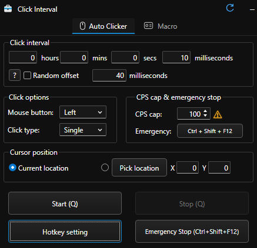

# Click Interval

Click Interval is an open-source Windows toolbox. The desktop app combines an
auto clicker, macro recorder, Minecraft server manager, voice changer,
crosshair tools, and an input display in one interface.

Website: [click-interval.netlify.app](https://click-interval.netlify.app/)



## Repository layout

- `apps/click-interval/` — complete buildable desktop application
- `editions/auto-macro/` — isolated Auto Clicker + Macro edition
- `tools/auto-clicker/` — auto-clicker ownership and source map
- `tools/macro/` — macro ownership and source map
- `tools/minecraft-server/` — server-hosting components and source map
- `tools/voice-changer/` — voice-processing components and source map
- `tools/crosshair/` — crosshair components and source map
- `tools/input-display/` — input-display components and source map
- `test/` — release, privacy, update, and integrity checks

The current desktop runtime predates this repository split, so several UI and
backend files are shared by more than one tool. The source maps document exact
ownership without duplicating build inputs or breaking runtime paths. New
tool-specific code should be placed in its matching tool folder.

## Run the full toolbox

On Windows, from `apps/click-interval`:

```powershell
npm ci
npm start
```

The checked-in source does not include Python, Electron, Gradle caches, server
worlds, logs, user settings, macros, private update credentials, or signing
keys.

## Auto Clicker + Macro release

The isolated edition is the first Authenticode signing target because it is the
public installer currently distributed to other users. Its source is in
`editions/auto-macro` and contains no Minecraft server hosting code or personal
data.

## Code signing policy

Click Interval stores user settings, macros, and hosted server data locally.
See the [privacy policy](PRIVACY.md), [complete code signing policy](SIGNING.md),
and [security policy](SECURITY.md).

Free code signing provided by SignPath.io, certificate by SignPath Foundation.
Every official Windows release is built from this public repository by GitHub
Actions and requires manual approval before signing. Until approval is granted,
downloads are clearly marked as unsigned previews.

Click Interval has no remote kill switch. Update checks only report signed
newer versions, and installation starts only after the local user chooses it.

## Install and uninstall

Download the latest archive from [GitHub Releases](https://github.com/mxnsinn/click-interval/releases),
extract it to a folder you control, and run `Click Interval.exe`. The preview
release is portable. To uninstall it, close Click Interval and delete the
extracted folder. User-created macros and settings are stored separately; their
locations are documented in the release notes so users can remove them too.

## License

[MIT](LICENSE)
